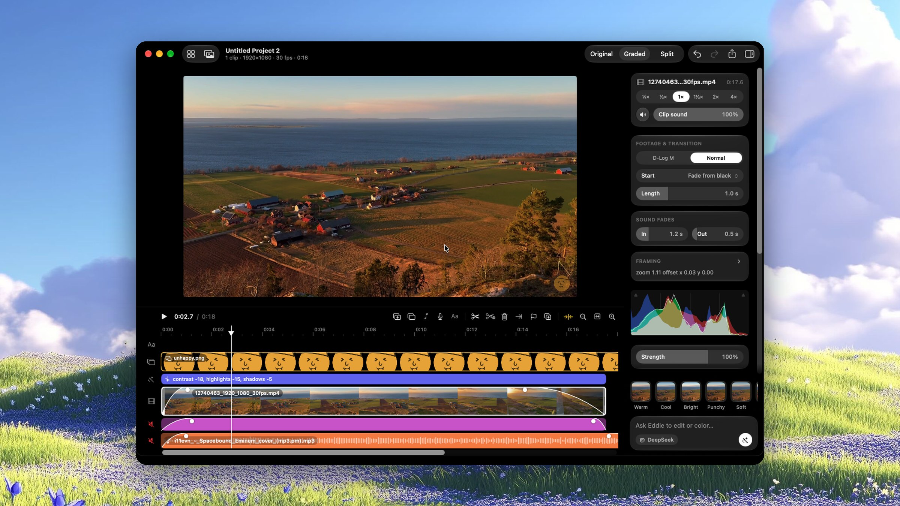
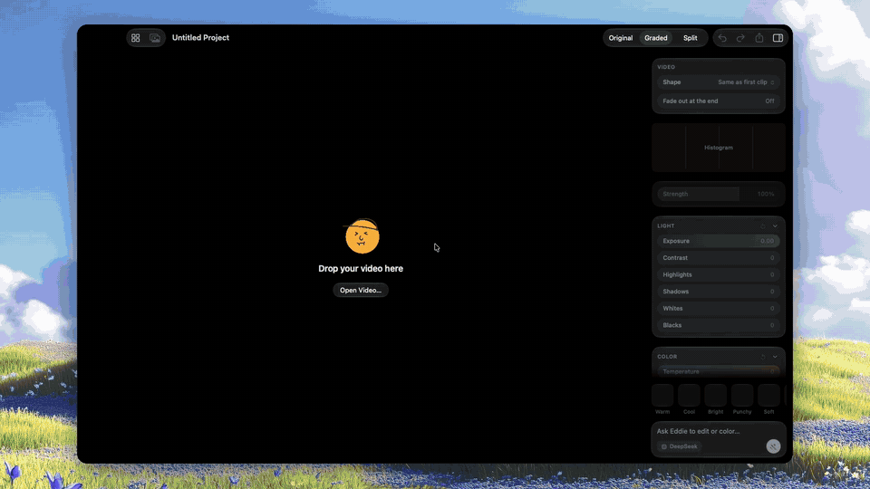

# Eddie

**A native macOS video editor where AI does the color grading for you.**



Drop in **log footage** — DJI D-Log or D-Log M from an Osmo Action, Pocket, Mini or Mavic, or any other
log profile — press **Auto Grade**, and an AI model looks at your clips and grades them for you:
exposure, contrast, white balance and more. Normal footage from a phone works too. Then edit like you
would in any editor, or just ask: *"cut the first clip at 4 s, put the beach shot first, add a 'Day 1'
title and make it warmer."*

<p align="center">
  
</p>
<p align="center"><sub>8K log footage → AI grade (sped up) · before/after · overlay moved, shrunk and tilted · serif yellow
title · music · fade lines · playback — <a href="docs/media/demo.mp4">full-quality video</a></sub></p>

Eddie is written in Swift and SwiftUI on top of AVFoundation and Core Image. Everything runs on
your Mac; the only thing that ever leaves it is what you send to the AI provider you choose.

> Requires **macOS 15 or later** (Liquid Glass styling on macOS 26) and **Xcode 16+**.

---

## Contents

- [Install](#install)
- [Build from source](#getting-started)
- [Set up the AI](#set-up-the-ai)
- [What it can do](#what-it-can-do)
- [Use it from your AI agent (MCP)](#use-it-from-your-ai-agent-mcp)
- [Keyboard shortcuts](#keyboard-shortcuts)
- [How it works](#how-it-works)
- [Privacy](#privacy)
- [Project layout](#project-layout)
- [Tests](#tests)
- [Credits](#credits)

---

## Install

Download **Eddie-x.y.z.dmg** from [Releases](../../releases), open it and drag **Eddie** to **Applications**.
It's signed and notarized by Apple, so it opens normally. Requires macOS 15 or later.

---

## Getting started

```sh
git clone <this repo>
cd eddie
brew install xcodegen      # once
xcodegen generate          # makes Eddie.xcodeproj from project.yml
open Eddie.xcodeproj       # then ⌘R
```

Or build a release app from the command line:

```sh
xcodebuild -project Eddie.xcodeproj -scheme Eddie -configuration Release -derivedDataPath build build
open build/Build/Products/Release/Eddie.app
```

To make a signed, notarized DMG like the one in Releases: `scripts/release.sh` (see the comments at the top
of the script for the one-time notarization setup).

---

## Set up the AI

Open **Settings (⌘,)**, pick a provider and paste its API key. Keys are kept in the macOS Keychain
(under "Eddie API Keys"); an environment variable works too.

| Provider | Default model | API key |
|---|---|---|
| **DeepSeek** (default) | `deepseek-flash` | `DEEPSEEK_API_KEY` |
| Gemini | `gemini-3.8-flash` | [aistudio.google.com/apikey](https://aistudio.google.com/apikey) · `GEMINI_API_KEY` |
| OpenAI | `gpt-5.5` | `OPENAI_API_KEY` |
| Claude | `claude-opus-5` | `ANTHROPIC_API_KEY` |

The model name can be changed per provider in Settings. Adding another provider means writing one type
that conforms to `VisionModel` (`Eddie/AI/VisionModel.swift`) and adding a case to `ProviderKind`.

Editing works without a key; only Auto Grade, "Ask Eddie" and AI color need one.

---

## What it can do

### AI
- **Auto Grade** — the model sees frames and measurements from a clip, sets ten grading knobs, renders
  the result and checks its own work (up to three rounds). *Clip ▸ Auto Grade All Clips* does the lot.
- **Ask Eddie** — type a request in the box at the bottom of the inspector. The AI edits with tools —
  split, trim, delete, move, duplicate, speed, volume, titles, music, transitions, fades, shape, framing,
  slow zoom, overlays, markers, reverse, freeze frame, sound clean-up, captions, beat finding, presets and
  color — looks at the result, and fixes anything until it's done. One request is one undo.
- **Strength** scales the whole grade; **presets** (Warm, Cool, Bright, Punchy, Soft, Vivid, Moody,
  Cinematic, Golden, Faded, Mono) preview on the frame under the playhead.

### Color
- Log footage is converted to normal-looking Rec.709 with a LUT first. DJI's **D-Log M** conversion is
  built in; for D-Log or another camera's log profile, choose its `.cube` LUT in Settings. Then come
  exposure, contrast, highlights, shadows, whites, blacks, temperature, tint, vibrance and saturation —
  all in 16-bit float.
- Each clip is marked **D-Log M** or **Normal** (detected automatically), so phone footage and photos mix
  in without being converted twice.
- **Original / Graded / Split** view to compare, with a live histogram.

### Editing
- Multiple clips and photos: drag to reorder (the others slide aside), trim from either edge, split,
  blade tool, duplicate, speed from ¼× to 4×, reverse, freeze frame.
- **Overlays** for B-roll and picture-in-picture — move, resize and rotate them right on the video.
- **Transitions** at any cut: cross dissolve, dip to black, wipe, slide.
- **Fade lines** on clips and songs: drag the dot at a block's top corner to fade the picture in from
  black, out to black, or the sound in and out.
- **Framing & motion**: zoom, position, rotation and crop per clip, with keyframes and a one-click
  Ken Burns slow zoom.
- **Titles**: title, lower third and caption styles; any font, weight, color and background plate; drag,
  resize and rotate on the video.
- **Auto captions** from speech, transcribed on your Mac.
- **Shape**: 16:9, 9:16 (Reels / TikTok / Shorts), 1:1 or 4:5, fill or fit.
- **Snapping** to the playhead, edges, markers and the music's beats.
- Multi-select, copy / cut / paste, **insert or overwrite** edits, markers, J/K/L shuttle, and a
  timeline that zooms (pinch, ⌘= / ⌘−) and keeps its scale while you edit.
- Full **undo / redo**.

### Audio
- Music, sound effects and **voiceovers recorded in the app**, on as many lanes as you need.
- Per-clip and per-lane volume and mute, fades, automatic ducking of clip sound under music, and music
  dipping under voiceover.
- **Normalize loudness** and **reduce background noise** (Apple's voice isolation), rendered to new files —
  your originals are never touched.
- **Find the beat** of a song so cuts can land on it.

### Projects, media and export
- A **Projects** screen; every project saves itself as you work. Projects only point to your media —
  nothing is copied or changed.
- A **media bin** per project (drag files in from Finder). If files move, Eddie helps you find them again.
- **1080p playback proxies** for 4K footage, and disk caches for thumbnails and waveforms.
- **Export** with presets (best quality, social 1080p, YouTube 4K, small file, ProRes master) or pick
  HEVC 10-bit / H.264 MP4 / ProRes 422, size and frame rate. Progress shows over the video, with Cancel.

---

## Use it from your AI agent (MCP)

Eddie includes an [MCP](https://modelcontextprotocol.io) server, so agents like **Claude Code**, **Claude Desktop**
or **Cursor** can edit your videos: open projects, add footage, cut, add overlays and titles, grade, look at
frames and export. Everything happens live in Eddie's window, and every change is one undo step.

1. In Eddie, open **Settings (⌘,) → AI Agents** and turn on **Let AI agents control Eddie**.
2. Connect your agent — the Settings pane has buttons that copy the exact command or config:

   ```sh
   # Claude Code
   claude mcp add eddie -- /Applications/Eddie.app/Contents/MacOS/eddie-mcp
   ```

   ```json
   // Claude Desktop, Cursor and other MCP apps
   { "mcpServers": { "eddie": { "command": "/Applications/Eddie.app/Contents/MacOS/eddie-mcp" } } }
   ```

3. Ask for an edit: *"Make a 15-second vertical cut of the clips in ~/Movies/trip, warm grade, add 'Day 1'
   in a serif font and fade out at the end. Export it to my Desktop."*

| Tool | What it does |
|---|---|
| `get_timeline` | The edit as text — clips c1…, overlays o1…, titles t1…, audio m1…, markers k1… |
| `get_frame` | An image of the finished, graded frame at any time |
| `list_projects` · `open_project` · `new_project` | Pick what to work on |
| `add_media` | Add videos, photos or audio as clips, overlays, music, effects, voiceovers or to the bin |
| `edit` | Every editing action: split, trim, move, speed, transitions, fades, titles, overlays, framing, Ken Burns, format, markers, reverse, freeze, audio clean-up, captions, beats… |
| `set_grade` · `auto_grade` | Set the grade's knobs directly, or let Eddie's AI colorist grade |
| `control` | Play, pause, seek, undo, redo, save |
| `export` | Render with a codec, size and frame rate |

The server (`eddie-mcp`, inside the app) talks to the running Eddie over a local socket that only your user
account can open. If Eddie isn't running, it opens it. Nothing is reachable from the network.

---

## Keyboard shortcuts

| Key | Action | | Key | Action |
|---|---|---|---|---|
| Space | Play / pause (stops a recording) | | ⌘B | Split at playhead |
| ← / → | Step one frame | | B | Blade tool (A or Esc to stop) |
| J / K / L | Shuttle back / stop / forward | | ⌫ | Delete |
| ↑ / ↓ | Previous / next cut or marker | | ⌘D | Duplicate |
| M | Add marker | | ⌘C / ⌘X / ⌘V / ⌘A | Copy / cut / paste / select all |
| N | Snapping on / off | | ⌥⌘F | Freeze frame |
| ⌘= / ⌘− | Zoom timeline | | ⌥⌘R | Reverse clip |
| ⇧Z | Fit timeline | | ⌥⌘T | Add title |
| ⌘I | Add clips or photos | | ⇧⌘I | Add overlay |
| ⌥⌘M | Add music | | ⇧⌘R | Record voiceover |
| ⌘E | Export | | ⌘0 | Projects |
| ⌘Z / ⇧⌘Z | Undo / redo | | ⌘N | New project |

---

## How it works

**Playback and export** — a project is compiled into an `AVMutableComposition` (clips alternate between
two video tracks so transitions can overlap; overlays and audio lanes get their own tracks) with an
`AVAudioMix` for volume curves, fades and ducking. Every frame is drawn by a custom
`AVVideoCompositing` compositor (`GradeCompositor`) that decodes 10-bit sources, applies the LUT and the
grade with a Metal Core Image kernel compiled at runtime, then lays out framing, overlays, transitions
and titles. The same path renders the viewer and the exported file.

**Auto Grade** — six frames are sampled from the clip, converted, and measured (brightness percentiles,
clipping, white-balance cast). The frames and numbers go to the vision model, which answers with knob
values as JSON. Eddie renders the result and sends it back for a check — up to three rounds.

**Ask Eddie** — the AI gets a text description of the timeline (clips labelled c1, c2…, overlays o1…,
titles t1…, audio m1…) plus frames, and replies with a JSON list of actions. Eddie applies them, describes
the new timeline, and lets the model continue until it says it's done (up to four rounds).

---

## Privacy

- Your videos, photos, audio and projects stay on your Mac. Projects live in
  `~/Library/Application Support/Eddie/Projects/`, files Eddie makes (reversed clips, cleaned audio,
  voiceovers, freeze frames) in `~/Library/Application Support/Eddie/Media/`, and caches in
  `~/Library/Caches/Eddie/`.
- When you use an AI feature, Eddie sends a few downscaled frames and a text description of the edit to
  the provider you picked — nothing else, and only when you ask.
- Captions use on-device speech recognition. API keys are stored in the macOS Keychain.

---

## Project layout

```
Eddie/
  App/        EddieApp (menus, shortcuts), EditorModel (all editor state, undo, playback)
  AI/         VisionModel + providers, GradingAgent, EditingAgent (AI editing tools), settings/Keychain
  Grade/      GradeRecipe (the ten knobs), CubeLUT, GradeRenderer, Metal kernel source, TitleRenderer
  Video/      GradeCompositor, Exporter + ExportSettings, Reverser, MediaCache (proxies, thumbnails)
  Audio/      AudioProcessor (normalize, noise reduction), BeatDetector, VoiceRecorder, Captioner
  Agent/      MCP for outside agents: tool definitions, the socket server, the tool handlers
  Project/    Project model, ProjectCompiler (→ AVComposition), ProjectLibrary (saving)
  Analysis/   FrameStats (histograms, clipping, white balance)
  UI/         SwiftUI views: viewer, timeline, inspector, media bin, projects, export, settings
  Resources/  App icon, DJI D-Log M LUT
EddieMCP/     eddie-mcp, the stdio MCP server agents launch (relays to the app)
EddieTests/   ~100 XCTest cases with small video/audio fixtures
docs/         Design notes
project.yml   XcodeGen project definition
```

---

## Tests

```sh
xcodebuild -project Eddie.xcodeproj -scheme Eddie -derivedDataPath build test
```

The suite covers grading math, the project model and compiler, transitions, overlays, audio mixing,
export, the AI action executor and more. A few opt-in tests need extra setup:

- **Live AI grading** on a real clip — `TEST_RUNNER_EDDIE_LIVE_CLIP=/path/to/clip.mp4` and a provider key.
- **Window snapshots** — `TEST_RUNNER_EDDIE_SNAPSHOT_OUT=/some/folder` renders the UI to PNGs.

The demo above is recorded by the app itself: launch it with `EDDIE_DEMO_OUT`, `EDDIE_DEMO_CLIP`,
`EDDIE_DEMO_OVERLAY` and `EDDIE_DEMO_MUSIC` set (see `Eddie/Demo/DemoDirector.swift`) and it plays a
scripted edit and records its own window. It needs Screen Recording permission.

---

## Credits

- The D-Log M → Rec.709 conversion LUT is published by **DJI** and is bundled for convenience; it
  belongs to DJI.
- Demo background art and footage are for illustration only.
- Built with SwiftUI, AVFoundation, Core Image, Speech and Accelerate.
